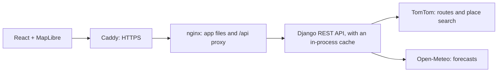

# Weather-Aware Truck Routing

**Live app: <https://3-24-117-219.sslip.io>**

A React and Django app that helps a truck driver choose the safest route. Enter an origin, destination, departure time and load weight, and it compares three routes using the forecast for when the truck will actually reach each point along the way.

- Three route options from a truck routing API
- Weather checked every 10, 25 or 50 miles, at the truck's estimated arrival time at each checkpoint
- Risk from the assessment's wind, rain, snow and load rules
- A recommended route, chosen in strict order: fewest Severe miles, fewest High miles, lowest average risk, shortest travel time
- An interactive map of routes, checkpoints, risk levels and ETAs
- A weather heatmap along the trip corridor with a 0–48 hour forecast slider

## Architecture



All risk logic is in the backend, as small functions that are easy to test. React only displays what the API returns, using types generated from the API's OpenAPI schema, and a test fails if the frontend ever compares a number to wind, rain or snow.

How a trip is planned, in `backend/routing/services/trip_planner.py`:

1. **Routes:** `route_alternatives.py` asks TomTom for three, drops near-duplicates, and forces detours if too few come back.
2. **Checkpoints:** `checkpoint_generator.py` places them along each route at the chosen interval.
3. **ETAs:** `eta_calculator.py` works out when the truck reaches each one, from TomTom's elapsed time along the route.
4. **Weather:** `weather_lookup.py` reads the forecast for that place at that time.
5. **Risk:** `risk_engine.py` classifies wind, rain and snow, applies the load rules, and takes the worst.
6. **Ranking:** `route_scorer.py` totals risk miles and ranks the routes.

The forecast slider never contacts the server. All 49 hourly frames arrive once, and moving the slider only changes one map paint property, so React doesn't re-render the map.

## Run it

You need a free [TomTom API key](https://developer.tomtom.com). Open-Meteo's free tier needs no key.

### With Docker

```bash
cp .env.example .env
# In .env, set TOMTOM_API_KEY, and DJANGO_SECRET_KEY to the output of: openssl rand -base64 48
docker compose up --build
```

Then open <http://localhost:8080>.

### For development

Requires Python 3.13 with [uv](https://docs.astral.sh/uv/), and Node 22.

```bash
# Terminal 1: the API, on port 8000
cd backend
uv sync
DJANGO_DEBUG=true TOMTOM_API_KEY=your-key uv run python manage.py runserver

# Terminal 2: the app, on port 5173, which proxies /api to port 8000
cd frontend
npm ci
npm run dev
```

## Configuration

`.env.example` lists every setting. In production the backend refuses to start without `DJANGO_SECRET_KEY`, `ALLOWED_HOSTS` and `TOMTOM_API_KEY`.

| Setting | Purpose |
| --- | --- |
| `TOMTOM_API_KEY` | Routes and place search. Stays on the server. |
| `DJANGO_SECRET_KEY` | Django's signing key. |
| `ALLOWED_HOSTS` | Comma-separated hostnames the app is served from. |
| `REDIS_URL` | Optional shared cache. Without it the app caches in its own process, which suits one server. |
| `OPEN_METEO_API_KEY` | Optional paid key, needed for commercial use. |
| `NUM_PROXIES` | Trusted proxies in front of the backend, used to find the client's IP. `docker-compose.yml` defaults to 1, the server uses 2, and it's 0 otherwise. |
| `DJANGO_SECURE_SSL_REDIRECT` | Set to `false` only if nothing in front of the app serves HTTPS. |
| `CORS_ALLOWED_ORIGINS` | Only needed if the frontend is on a different origin. |

## API

The full reference is the OpenAPI schema at `backend/schema.yml`.

| Endpoint | Purpose |
| --- | --- |
| `POST /api/v1/trips/plan` | Ranked routes with risk segments, checkpoints, ETAs and summaries |
| `POST /api/v1/trips/heatmap` | Risk at each corridor point for each of the 49 hours |
| `GET /api/v1/geocode?q=` | Place search for the form |
| `GET /api/v1/health` | Health check |

Errors share one shape: `{"code", "message", "fields"}`, where `fields` only appears on validation errors.

| Status | `code` | Meaning |
| --- | --- | --- |
| 400 | `validation_error` | Invalid input, with details in `fields` |
| 422 | `no_route` | No truck route connects the two places |
| 429 | `rate_limited` | Too many requests, here or at a provider |
| 503 | `busy` | The server is at its limit for trips running at once |
| 429 | `quota_exhausted` | The weather budget for this IP or the whole app was reached |
| 503 | `provider_unavailable` | The routing or weather service is down |

## Tests

```bash
# Backend
cd backend
uv run pytest
uv run ruff check . && uv run ruff format --check .
DJANGO_DEBUG=true uv run mypy .

# Frontend
cd frontend
npm test -- --run
npm run lint && npm run typecheck && npm run format:check

# Browser tests, on the production build (first run: npx playwright install chromium)
npx playwright test

# Against real providers, which spends quota. The API must be running on port 8000.
PLAYWRIGHT_LIVE=1 npx playwright test
```

Browser tests run real Chromium with WebGL. API responses come from fixtures typed against the API schema, and any console error or outside request fails the test. Fixtures exist only in test directories, so the app itself never uses mock data.

[docs/requirements-audit.md](docs/requirements-audit.md) maps each assessment requirement to the test or live check that proves it.

## CI

GitHub Actions runs on every pull request and every push to `main`:

| Job | What it checks |
| --- | --- |
| `backend` | ruff, mypy, pytest, and that the OpenAPI schema is current |
| `frontend` | ESLint, TypeScript, Vitest, the build, and that the generated API types are current |
| `e2e` | The Playwright browser tests |
| `docker` | Starts the full stack with Compose, then checks the API proxy, worker content type and compression |
| `commit-policy` | On pull requests: every commit is Verified, by the right author, with no tool attribution |

CI needs no secrets and never calls the real providers. The separate `Live smoke test` workflow does, so it only runs when started by hand, and it needs a `TOMTOM_API_KEY` repository secret.

When CI passes on `main`, the `Deploy` workflow publishes the images and deploys them through GitHub OIDC.

## Decisions where the assessment leaves room

| Question | Decision | Why |
| --- | --- | --- |
| A value on a shared endpoint, such as rain at 0.25 | It takes the higher risk class. Rain 1.00 and snow 3.0 stay Severe, because No Travel is strictly above them. | Errs on the side of safety, and the table's own wording requires the exceptions |
| Wind between bands, such as 34.5 mph | Bands are continuous: 25 up to 35 is Moderate, and so on | The table lists whole numbers, but forecasts have decimals |
| Final risk at a checkpoint | The worst of wind (after load rules), rain and snow | A single severe condition is enough to make a road unsafe |
| What load rules apply to | Wind only, and exactly 30,000 lb or 40,000 lb doesn't trigger them | As written in the assessment |
| What "load weight" means | Cargo. Risk rules compare it directly, and routing adds an assumed 33,000 lb truck | A truck's empty weight alone would exceed the 30,000 lb rule |
| No Travel in the ranking | Routes with No Travel miles rank last and are never recommended. If all have them, the app says no route is safe. | The assessment's order never mentions No Travel, so read literally it could recommend a route the rules forbid |
| Risk miles | Each checkpoint represents the distance between the midpoints with its neighbours, so a route's risk miles sum to its length | Gives each checkpoint a fair share of the road |
| Average risk | Distance-weighted over known weather, with Low 0, Moderate 1, High 2, Severe 3, No Travel 4 | Long stretches count for more than short ones |
| Missing weather | Shown as unavailable, never estimated. Routes with missing miles rank after complete routes, most complete first, and a route with no known weather is never recommended. | A guess could hide real danger, and unknown miles can't count as safe |
| Slider hour 0 | The departure time | The forecast that matters is the one for this trip |
| Rest stops | Not modelled, so ETAs assume continuous driving | The assessment doesn't provide hours-of-service rules |

Other choices made along the way:

- **Truck speed is capped at about 65 mph.** Without this, TomTom assumes legal limits. Dallas to Denver averaged about 75 mph, which would have read each checkpoint's weather too early.
- **Average risk can outweigh hours of driving.** The strict order means a tiny difference decides before travel time does. A live run chose 17h 21m over 13h 22m for an average risk of 0.025 against 0.031. This follows the assessment's rule as written.
- **The heatmap is a blurred circle layer, not a MapLibre heatmap layer.** A heatmap layer colours by how much points overlap, which drew No Travel as pale as Moderate. Here colours always match the legend. Low is a faint tint so calm weather still shows the corridor, and missing hours are grey so they can't pass for safe.
- **If the base map fails to load, a blank background takes its place,** so routes and checkpoints still draw.
- **Place search is US-only,** because the rules use miles, mph and pounds.

## Limits to know about

| Provider | Limit | What it means here |
| --- | --- | --- |
| Open-Meteo, free tier | 600 locations a minute, 5,000 an hour, 10,000 a day. Each location counts as one call, which we measured because the docs don't say. Non-commercial use only. | A coast-to-coast trip at 10-mile sampling uses about 850 locations. On an empty cache it waits out the per-minute limit once and takes about 80 seconds. About 8 such trips with heatmaps use the daily limit. |
| TomTom, free tier | Sources disagree on the current quota, so check your dashboard. | Each plan uses one request, or up to three if detours are needed. Its terms don't allow caching results for several users, so repeat trips and searches aren't cached. |

Forecasts are cached in the app's memory for an hour by location, on a grid of about 3.5 miles, so a restart or update empties the cache. Each IP can make 30 plans and 30 heatmaps an hour, and 120 place searches a minute. Each IP can also fetch 1,500 new forecast locations an hour, and the whole app stays under Open-Meteo's free limits. See [docs/deployment.md](docs/deployment.md#quota-protection).

## Load testing

[docs/load-testing.md](docs/load-testing.md) covers how to test capacity without spending provider quota or touching production.

## Deploying

The app runs on one Amazon Lightsail server for $7 a month. After CI passes on `main`, GitHub publishes new images, signs in to AWS through GitHub OIDC, and updates the server, which rolls back if the new version isn't healthy. GitHub stores no AWS keys. [docs/deployment.md](docs/deployment.md) covers how it works, how to set up a server, and how to operate it.

## Repository rules

Every decision made during the build, with its reasoning, is in [docs/decisions.md](docs/decisions.md). Commits and contribution rules are in `CLAUDE.md`. In short: pull requests only, every commit signed and Verified, and CI green before merging.
