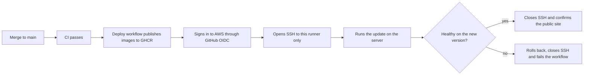
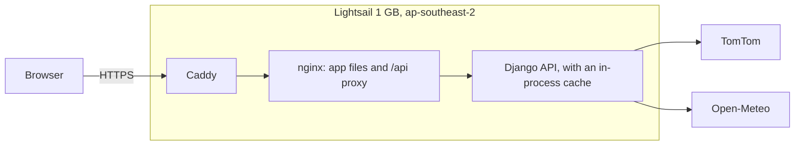

# Deployment

The app runs on one Amazon Lightsail server, and deploys automatically after CI passes on `main`.





## How deploys work

1. A merge to `main` runs CI.
2. If CI passes, the `Deploy` workflow publishes both images, tagged with the commit, then moves the `production` tag to them.
3. The workflow signs in to AWS through GitHub OIDC, so it gets credentials that expire and GitHub stores no AWS keys.
4. It opens port 22 to its own IP, gets a short-lived SSH key from Lightsail, and starts `deploy/update.sh` on the server. The server's host key is pinned in the `SERVER_KNOWN_HOSTS` variable.
5. The script checks out that commit, starts the images and confirms the version through nginx. If the new version isn't healthy, it rolls back and won't retry that commit until a newer one is published. The workflow then fails.
6. The workflow closes port 22, even after a failure, then confirms the public site reports the new version.

## What GitHub can do in AWS

| Limit | How |
| --- | --- |
| Which workflows can sign in | The role in `deploy/aws/github-trust-policy.json` trusts only this repository's `production` environment |
| Which branches can use that environment | The environment only allows `main` |
| What the role can do | `deploy/aws/github-deploy-policy.json` allows getting SSH access to this one server, and opening or closing its ports. It can't create or delete anything, or reach any other service. |

The SSH access gives root on this server, because the `ubuntu` user has `sudo`. Treat a merge to `main` as deploying to production.

## Set up a new server

These are one-time steps, using the AWS CLI with a profile signed in through `aws login`. Lightsail must be in your project's Region.

### 1. Create the server and its address

```bash
export AWS_PROFILE=truck-routing AWS_REGION=ap-southeast-2

aws lightsail create-instances \
  --instance-names truck-routing \
  --availability-zone "${AWS_REGION}a" \
  --blueprint-id ubuntu_24_04 \
  --bundle-id micro_3_2 \
  --user-data file://deploy/bootstrap.sh

aws lightsail allocate-static-ip --static-ip-name truck-routing-ip
aws lightsail attach-static-ip --static-ip-name truck-routing-ip --instance-name truck-routing
```

The address is the static IP with dots replaced by dashes, so `203.0.113.7` becomes `203-0-113-7.sslip.io`.

### 2. Open only web traffic, plus SSH for your own IP for now

```bash
aws lightsail put-instance-public-ports --instance-name truck-routing --port-infos \
  'fromPort=80,toPort=80,protocol=tcp' \
  'fromPort=443,toPort=443,protocol=tcp' \
  "fromPort=22,toPort=22,protocol=tcp,cidrs=$(curl -fsS https://checkip.amazonaws.com)/32"
```

### 3. Add the settings

Sign in with short-lived credentials from Lightsail's browser SSH console, or `aws lightsail get-instance-access-details`. Then create `/opt/truck-routing/.env`, readable only by root:

```bash
DJANGO_SECRET_KEY=<output of: openssl rand -base64 48>
TOMTOM_API_KEY=<your key>
SITE_ADDRESS=203-0-113-7.sslip.io
ALLOWED_HOSTS=203-0-113-7.sslip.io
```

Then read the host key for step 5, from this signed-in session:

```bash
cut -d' ' -f1,2 /etc/ssh/ssh_host_ed25519_key.pub
```

### 4. Close SSH

```bash
aws lightsail put-instance-public-ports --instance-name truck-routing --port-infos \
  'fromPort=80,toPort=80,protocol=tcp' \
  'fromPort=443,toPort=443,protocol=tcp'
```

### 5. Connect GitHub to AWS

```bash
gh variable set PRODUCTION_URL --body 'https://203-0-113-7.sslip.io'
gh variable set SERVER_KNOWN_HOSTS --body '203.0.113.7 ssh-ed25519 <host key from step 3>'

# Put the new server's ARN in deploy/aws/github-deploy-policy.json first.
# GitHub's token subject uses immutable IDs here, so the trust policy's `sub` must match this prefix:
# gh api repos/ahmadrashad1/Weather-Aware-Truck-Routing/actions/oidc/customization/sub
aws iam create-open-id-connect-provider \
  --url https://token.actions.githubusercontent.com --client-id-list sts.amazonaws.com
aws iam create-role --role-name truck-routing-github-deploy \
  --assume-role-policy-document file://deploy/aws/github-trust-policy.json
aws iam put-role-policy --role-name truck-routing-github-deploy \
  --policy-name reach-truck-routing-server \
  --policy-document file://deploy/aws/github-deploy-policy.json

gh variable set AWS_DEPLOY_ROLE_ARN \
  --body "$(aws iam get-role --role-name truck-routing-github-deploy --query Role.Arn --output text)"
gh api -X PUT repos/ahmadrashad1/Weather-Aware-Truck-Routing/environments/production \
  --input - <<< '{"deployment_branch_policy":{"protected_branches":false,"custom_branch_policies":true}}'
gh api -X POST repos/ahmadrashad1/Weather-Aware-Truck-Routing/environments/production/deployment-branch-policies \
  -f name=main -f type=branch
```

Then run the `Deploy` workflow by hand for the first deploy.

Rebuilding the server changes its ARN and host key, so update the role's policy and `SERVER_KNOWN_HOSTS` afterwards.

## Operating it

Open port 22 for your IP as in step 2, connect, then close it again afterwards.

| Task | How |
| --- | --- |
| See what's running | `curl https://<address>/api/v1/health` |
| Read update logs | The `Deploy` workflow run shows them, or `journalctl -u truck-routing-update` on the server |
| Read app logs | `cd /opt/truck-routing/repo && IMAGE_TAG=$(cat ../state/current) docker compose --env-file ../.env -f docker-compose.yml -f deploy/docker-compose.prod.yml --project-name truck-routing logs` |
| See a revision that failed | `cat /opt/truck-routing/state/failed` |
| Change a setting | Edit `.env`, delete `state/current`, then run the `Deploy` workflow by hand. |
| Roll back | Revert the commit on `main`. The revert deploys like any other change. |
| Redeploy without a code change | Run the `Deploy` workflow by hand. |

## Limits of this setup

- **One server:** if it fails, the app is down until it's restarted. Each update causes a short outage while containers restart.
- **Slow first trip:** the cache lives in the app's process, so each update or restart empties it. Rate limit counts reset too.
- **SSH during deploys:** port 22 is open to the runner's IP for the length of the deploy. If a run is cancelled before it can close, the rule stays until the next deploy, limited to that one IP.
- **One worker:** the cache isn't shared between processes, so the backend stays on one worker. To add more, set `REDIS_URL` and add Redis.
- **Provider quotas:** see "Limits to know about" in the README. Commercial use needs a paid Open-Meteo key.
- **AWS costs:** the project is on the Paid plan, so charges past its credits are billed.
- **`sslip.io`:** the address and its certificate depend on that free third-party service.
