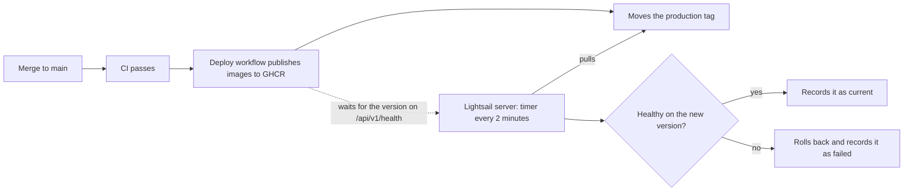
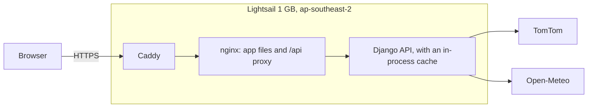

# Deployment

The app runs on one Amazon Lightsail server, and updates itself after CI passes on `main`.





## How updates work

1. A merge to `main` runs CI.
2. If CI passes, the `Deploy` workflow publishes both images, tagged with the commit, then moves the `production` tag to them.
3. Every 2 minutes, `deploy/update.sh` on the server checks that tag. If it's new, the script checks out that commit, starts the images and confirms the version through nginx.
4. If the new version isn't healthy, the script rolls back and won't retry that commit until a newer one is published.
5. The workflow waits for `/api/v1/health` to report the new version, so a failed deploy shows as a failed workflow.

GitHub holds no AWS credentials or SSH keys, and port 22 stays closed. GitHub OIDC isn't used because projects in the new AWS experience can't create identity providers: the managed policy denies `iam:*Provider*` on both the Free and Paid plans.

## Set up a new server

These are one-time steps, using the AWS CLI with a profile signed in through `aws login`. Lightsail must be in your project's Region.

### 1. Create the server and its address

```bash
export AWS_PROFILE=truck-routing AWS_REGION=ap-southeast-2

aws lightsail create-instances \
  --instance-names truck-routing \
  --availability-zone "${AWS_REGION}a" \
  --blueprint-id ubuntu_24_04 \
  --bundle-id micro_3_2 \
  --user-data file://deploy/bootstrap.sh

aws lightsail allocate-static-ip --static-ip-name truck-routing
aws lightsail attach-static-ip --static-ip-name truck-routing --instance-name truck-routing
```

The address is the static IP with dots replaced by dashes, so `203.0.113.7` becomes `203-0-113-7.sslip.io`.

### 2. Open only web traffic, plus SSH for your own IP for now

```bash
aws lightsail put-instance-public-ports --instance-name truck-routing --port-infos \
  'fromPort=80,toPort=80,protocol=tcp' \
  'fromPort=443,toPort=443,protocol=tcp' \
  "fromPort=22,toPort=22,protocol=tcp,cidrs=$(curl -fsS https://checkip.amazonaws.com)/32"
```

### 3. Add the settings

Sign in with short-lived credentials from Lightsail's browser SSH console, or `aws lightsail get-instance-access-details`. Then create `/opt/truck-routing/.env`, readable only by root:

```bash
DJANGO_SECRET_KEY=<output of: openssl rand -base64 48>
TOMTOM_API_KEY=<your key>
SITE_ADDRESS=203-0-113-7.sslip.io
ALLOWED_HOSTS=203-0-113-7.sslip.io
```

The timer starts deploying once this file exists.

### 4. Close SSH

```bash
aws lightsail put-instance-public-ports --instance-name truck-routing --port-infos \
  'fromPort=80,toPort=80,protocol=tcp' \
  'fromPort=443,toPort=443,protocol=tcp'
```

### 5. Tell GitHub where to check

```bash
gh variable set PRODUCTION_URL --body 'https://203-0-113-7.sslip.io'
```

## Operating it

Open port 22 for your IP as in step 2, connect, then close it again afterwards.

| Task | How |
| --- | --- |
| See what's running | `curl https://<address>/api/v1/health` |
| Read update logs | `journalctl -u truck-routing-update` |
| Read app logs | `cd /opt/truck-routing/repo && IMAGE_TAG=$(cat ../state/current) docker compose --env-file ../.env -f docker-compose.yml -f deploy/docker-compose.prod.yml --project-name truck-routing logs` |
| See a revision that failed | `cat /opt/truck-routing/state/failed` |
| Change a setting | Edit `.env`, then delete `state/current`. The next timer run redeploys the same revision. |
| Roll back | Revert the commit on `main`. The revert deploys like any other change. |
| Redeploy without a code change | Run the `Deploy` workflow by hand. |

## Limits of this setup

- **One server:** if it fails, the app is down until it's restarted. Each update causes a short outage while containers restart.
- **Slow first trip:** the cache lives in the app's process, so each update or restart empties it. Rate limit counts reset too.
- **One worker:** the cache isn't shared between processes, so the backend stays on one worker. To add more, set `REDIS_URL` and add Redis.
- **Provider quotas:** see "Limits to know about" in the README. Commercial use needs a paid Open-Meteo key.
- **Free plan:** a project on the Free plan closes after 6 months or when its credits run out. Upgrade in AWS Settings to keep the app running after that.
- **`sslip.io`:** the address and its certificate depend on that free third-party service.
