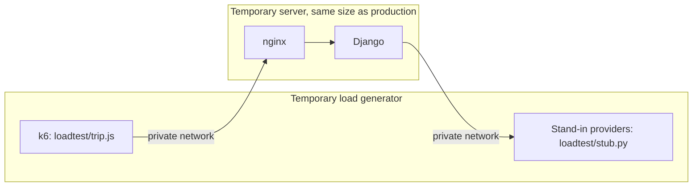

# Load testing

Load tests run on temporary servers against a stand-in for TomTom and Open-Meteo. They never touch production, and they spend no provider quota.



## Safeguards

- The app refuses to start with `PROVIDER_STUB_URL` set when HTTPS redirects are on, and production always turns them on.
- The stand-in invents all its data, because TomTom's terms don't allow storing its results.
- The stand-in lifts the per-IP limits, because one generator is one IP and the aim is to find the server's own limits. Production's quota budget is much lower, so read results alongside "Quota protection" in [deployment.md](deployment.md).

## Running a test

1. Create two Lightsail servers with `deploy/bootstrap.sh`: a target the same size as production, and a larger generator.
2. On the generator, start the stand-in:

   ```bash
   docker run -d --name stub --network host -v "$PWD/loadtest:/loadtest" python:3.13-slim python /loadtest/stub.py
   ```

3. On the target, start the stack. Use a published revision and the generator's private IP:

   ```bash
   IMAGE_TAG=<revision> PROVIDER_STUB_URL=http://<generator-ip>:9000 \
   DJANGO_SECRET_KEY=<any-long-value> TOMTOM_API_KEY=stub ALLOWED_HOSTS='*' \
   docker compose -f docker-compose.yml -f loadtest/docker-compose.loadtest.yml up --detach --no-build --wait
   ```

   Add `-f deploy/docker-compose.scale.yml` to test Redis and more workers.

4. On the generator, run a scenario:

   ```bash
   BASE_URL=http://<target-ip>:8080 loadtest/run.sh normal 10:5m,25:5m,50:5m,100:5m,250:5m,500:5m
   ```

5. Delete both servers when you're done.

## Scenarios

| Scenario | What it does |
| --- | --- |
| `normal` | A different trip each time, so the weather cache rarely helps |
| `overlap` | A few popular trips, which shows what the cache is worth |
| `long` | Coast to coast at 10-mile checks, the heaviest request |

Change the stand-in while a test runs, with `curl -X POST 'http://<generator-ip>:9000/__control?...'`:

| Setting | Effect |
| --- | --- |
| `mode=hang` | Providers stop answering |
| `mode=error` | Providers return 503 |
| `delay_scale=10` | Providers answer ten times slower |
| `minute_limit=600` | Applies Open-Meteo's per-minute limit |

A database pressure scenario doesn't apply, because the app has no database.

## Results so far

These are from one partial run on 2026-11-01, on a new 1 GB server with no burst capacity. Each stage planned a different trip each time, so the cache rarely helped. The test was stopped early, so capacity isn't established.

| Code | Users | Plan, median and p95 | Heatmap, median and p95 | Search, median and p95 | Failed |
| --- | --- | --- | --- | --- | --- |
| Before the speedups | 10 | 4.7 s, 11.1 s | 2.6 s, 4.3 s | 0.31 s, 0.56 s | 0 of 360 |
| Before the speedups | 25 | 9.9 s, 20.4 s | 7.0 s, 11.8 s | 2.5 s, 6.6 s | 0 of 207 |

The 25-user stage passed its limit of 5 seconds for searches at p95, and k6 stopped it early. Django handled those searches in under 0.5 s, so the wait was queueing for CPU, with the backend using about one full core.

Provider quota runs out long before this. The first two stages asked for about 65,000 forecast locations in 8 minutes, while Open-Meteo's free tier allows 10,000 a day.

**Not measured:** the speedups at the same load, more than 25 users, Redis and more workers, `HEAVY_REQUEST_LIMIT` being reached, the `overlap` and `long` scenarios, provider slowdowns and outages under load, spikes, and long runs.
