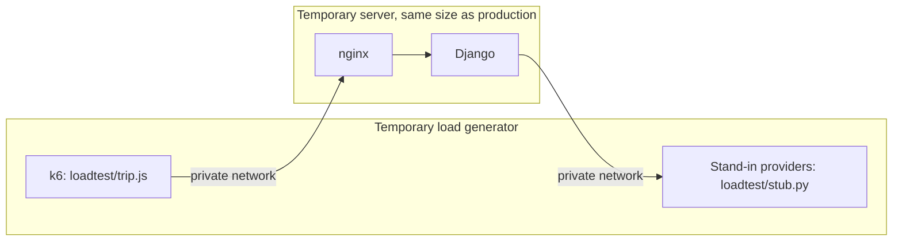

# Load testing

Load tests run on temporary servers against a stand-in for TomTom and Open-Meteo. They never touch production, and they spend no provider quota.



## Safeguards

- The app refuses to start with `PROVIDER_STUB_URL` set when HTTPS redirects are on, and production always turns them on.
- The stand-in invents all its data, because TomTom's terms don't allow storing its results.
- The stand-in lifts the per-IP limits, because one generator is one IP and the aim is to find the server's own limits. Production's quota budget is much lower, so read results alongside "Quota protection" in [deployment.md](deployment.md).

## Running a test

1. Create two Lightsail servers with `deploy/bootstrap.sh`: a target the same size as production, and a larger generator.
2. On the generator, start the stand-in:

   ```bash
   docker run -d --name stub --network host -v "$PWD/loadtest:/loadtest" python:3.13-slim python /loadtest/stub.py
   ```

3. On the target, start the stack. Use a published revision and the generator's private IP:

   ```bash
   IMAGE_TAG=<revision> PROVIDER_STUB_URL=http://<generator-ip>:9000 \
   DJANGO_SECRET_KEY=<any-long-value> TOMTOM_API_KEY=stub ALLOWED_HOSTS='*' \
   docker compose -f docker-compose.yml -f loadtest/docker-compose.loadtest.yml up --detach --no-build --wait
   ```

   Add `-f deploy/docker-compose.scale.yml` to test Redis and more workers.

4. On the generator, run a scenario:

   ```bash
   BASE_URL=http://<target-ip>:8080 loadtest/run.sh normal 10:5m,25:5m,50:5m,100:5m,250:5m,500:5m
   ```

5. Delete both servers when you're done.

## Scenarios

| Scenario | What it does |
| --- | --- |
| `normal` | A different trip each time, so the weather cache rarely helps |
| `overlap` | A few popular trips, which shows what the cache is worth |
| `long` | Coast to coast at 10-mile checks, the heaviest request |

Change the stand-in while a test runs, with `curl -X POST 'http://<generator-ip>:9000/__control?...'`:

| Setting | Effect |
| --- | --- |
| `mode=hang` | Providers stop answering |
| `mode=error` | Providers return 503 |
| `delay_scale=10` | Providers answer ten times slower |
| `minute_limit=600` | Applies Open-Meteo's per-minute limit |

A database pressure scenario doesn't apply, because the app has no database.
