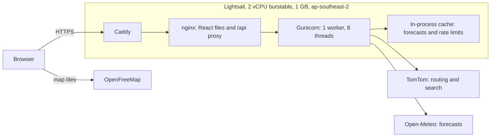
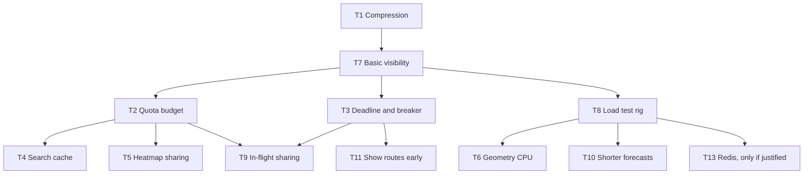
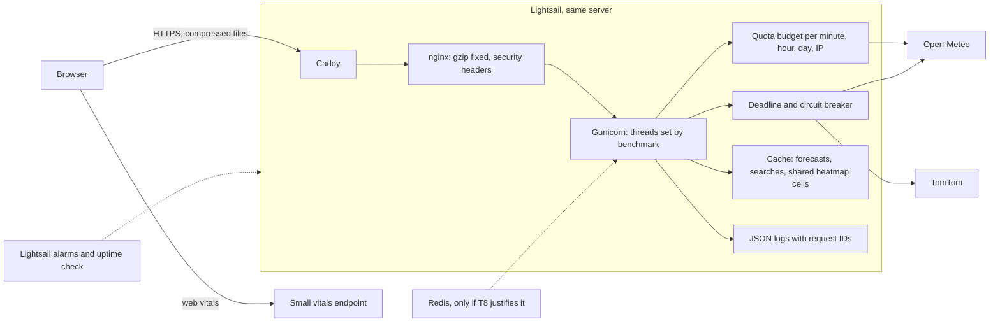

# Performance Audit and Scalability Plan

Audited on 2026-11-01 at commit `26e7e82`. Updated on 2026-11-02 with what's been done since.

**How to read the evidence labels**

| Label | Meaning |
| --- | --- |
| Measured (live) | Taken from the production site, from one machine with about 350 ms connection time |
| Measured (local) | Taken on a development machine with synthetic routes and no network calls |
| Calculated | Worked out from the code's own layout functions and published limits |
| Code | Read directly from the source |
| Not measured | Needs profiling or load testing before anyone relies on it |

**What this audit couldn't see**

- Real traffic. There are no analytics or metrics, and the brief says real users exist, but nothing in the system can confirm how many.
- Server logs and per-container metrics, because SSH stays closed and opening it would change production configuration.
- TomTom's quota and caching terms. These need checking on your dashboard and contract.
- Capacity under concurrent load. No load test was run, because it would spend free-tier quota and affect the live site. **This report makes no claim about how many users the app can handle.**

---

## Status at 2026-11-02

**Revision `c15e956` is live.** The sections after this one are the original audit from 2026-11-01, kept for reference, so where they disagree, this section is correct.

**Capacity is still not established.** The load test stopped early at your request, so no user number can be claimed from it.

### Tasks

| Task | Status | Evidence |
| --- | --- | --- |
| T1 Compression | Done | First-load bytes fell from 1,576,717 to 460,740 on the live site |
| T2 Quota budget | Done | Automated tests. Never triggered on the live site, because that would spend quota |
| T3 Deadline and breaker | Done | The real server setup, run locally against a hanging provider: 61 of 61 health checks fast, plans failed cleanly in about 61 s |
| T4 Search cache | Dropped | TomTom's terms, clause 11.4, forbid it |
| T5 Heatmap sharing | Not started | Changes what's graded, so it needs review first |
| T6 Geometry CPU | Done | 2.47 s to about 1.37 s for a long plan on invented routes, with identical output across 1,805 checkpoints |
| T7 Monitoring | Done, one step left | Report, uptime check and alarms all work. Alarm emails need your address |
| T8 Load test | Partly done | Setup built and working. Results below are partial |
| T9 In-flight sharing | Not started | |
| T10 Forecast length | Done | About half the time and a fifth of the data per batch. Live near and far trips had no `unknown` checkpoints. Memory saved on a real server isn't measured |
| T11 Show routes early | Not started | Changes what's graded. Must keep routes in the browser, under clause 11.4 |
| T12 Cancel old requests | Not started | |
| T13 Redis and more workers | Built, off | `deploy/docker-compose.scale.yml` exists, but was never run or compared |
| T14 Security and credits | Partly done | Credits done. Page security headers and dependency scanning not started |
| T15 Deployment safety | Not started | The rollback drill and outage measurement haven't run |
| T16 Protect the workers | Partly done | Six heavy requests at once, then a `busy` error. The limit has never been reached in a test, and thread count is unchanged |
| T17 Bundle review | Not started | |
| T18 CDN | Not started | |
| T19 TomTom compliance | Done | Live: repeat searches make new requests, and the credit comes from the Copyright API |

### Load test results

Run on 2026-11-01 on a new 1 GB server, with stand-in providers and invented routes. Each iteration used a different trip, so the cache rarely helped (7% hit rate). This is the expensive case, not typical use.

| Run | Users | Plan, median and p95 | Heatmap, median and p95 | Search, median and p95 | Failed | Measured by |
| --- | --- | --- | --- | --- | --- | --- |
| Before T6, T10, T16 | 10 | 4.7 s, 11.1 s | 2.6 s, 4.3 s | 0.31 s, 0.56 s | 0 of 360 | k6 |
| Before T6, T10, T16 | 25 | 9.9 s, 20.4 s | 7.0 s, 11.8 s | 2.5 s, 6.6 s | 0 of 207 | k6 |
| After, stopped after about 3 minutes | 10 | 3.6 s, 7.8 s | 2.0 s, 3.1 s | 0.29 s, 0.34 s | 0 of 231 | Django logs |

- **The last row isn't a fair comparison.** It's a partial stage, and Django's logs leave out queueing and network time that k6 includes. It suggests an improvement but doesn't prove one.
- **The 25-user stage passed its limit,** which was 5 s for searches at p95, and stopped early. Django handled those searches in under 0.5 s, so the wait was queueing for CPU, with the backend at about one full core.
- **Burst capacity read 0% throughout.** A new server starts with none, so production may do better while it has burst left. CPU steal wasn't captured, so I can't say how much throttling affected this.
- **Memory held:** 797 of 909 MB at peak, with 125 MB of swap and no restarts. That's less headroom than the earlier 583 MB measurement.
- **Open-Meteo's quota is the first real limit.** The first two stages asked for about 65,000 locations in 8 minutes, against 10,000 a day on the free tier. On the live site, the budget would refuse new trips long before CPU became the problem.

**Not tested:** the speedups at the same load, more than 25 users, the `busy` limit, Redis and more workers, the `overlap` and `long` scenarios, provider slowdowns and outages under load, spikes, long runs, and HTTPS through Caddy. The real browser scenarios weren't repeated either.

### What to expect during user testing

- **New-trip limits:** each IP can fetch 1,500 new forecast locations an hour, and the whole app 4,750 an hour and 9,500 a day. Heatmaps stop first. Depending on how much trips overlap, expect roughly 33 to 118 new trips a day at 25-mile checks. Testers sharing an office network share one IP limit.
- **When limits are reached:** testers see a clear `quota_exhausted` or `busy` message, never a route falsely marked safe.
- **Updates:** each merge restarts the app, empties its cache and resets the budget counts and report.
- **Watching it:** run `gh workflow run report.yml` and read the log. Totals are public, because the repository is.

### Open risks

- **Open-Meteo:** the free tier is non-commercial only, and its terms allow blocking an IP. Every user shares the server's IP.
- **TomTom:** check whether your key is for evaluation only. Clause 12 needs an end-user agreement, and the safety-use clause, 11.6.9, needs a lawyer's view before real commercial use. Your search and routing quota is still unconfirmed.
- **Rollback:** it has never run after a real failed deploy.
- **Alarm emails:** none are sent until you add your address.
- **One server:** there's no failover or backup, though it can be rebuilt from the repository and docs, apart from `.env`.

### Changes to the original plan

| Change | Reason |
| --- | --- |
| No server cache of TomTom results, including routes | Clause 11.4 bans caching that serves several users |
| Load test routes are invented, not recorded | Clause 11.4 also limits storing results |
| T11 must keep routes in the browser | Same clause |
| T13 stays off until measured | The comparison didn't run, and memory is already tight |
| Trips over budget are refused whole, rather than shown as `unknown` | Partly checked routes would rank by what was fetched, not by weather |

The temporary servers ran for about 20 minutes and are deleted.

### Recommended next steps

1. Run user testing, and read the `Server report` afterwards. Real cache hit rates will show how much quota real use takes.
2. Set up the alarm emails.
3. After submission, finish the load test on a server with some burst capacity, then decide on T13.
4. Run the T15 rollback drill before relying on automatic rollback.
5. Add T14's headers and scanning.

### T19 details

| | |
| --- | --- |
| **Priority** | High. Done on 2026-11-02 |
| **Problem** | 1. The browser keeps search results for an hour (`SEARCH_CACHE_MS` in `frontend/src/api/queries.ts`), but TomTom's search responses have no cache headers, and clause 11.4.1 allows client caching only where they're present. 2. Clause 17.3 requires attribution from TomTom's Copyright API and written approval to use its trade names. The current credit is hand-written |
| **Change** | Stop keeping search results after they're used, keeping the debounce and cancellation. Replace the hand-written TomTom credit with the caption from the Copyright API, which returned `©TomTom` with `max-age=86400` |
| **Files** | `frontend/src/api/queries.ts`, `frontend/src/components/DataCredit.tsx`, `routing/providers/tomtom.py`, `routing/api/views.py`, `routing/api/urls.py`, `backend/schema.yml` |
| **Impact** | Somewhat more TomTom search calls when someone retypes the same text. No effect on risk results |
| **Complexity** | Low |
| **Testing** | A repeat search makes a new request. The credit shows the API's caption, and a failure doesn't break the page |
| **Acceptance** | No TomTom search result outlives its use in the browser, and the credit comes from the Copyright API |

---

## 1. Executive Summary

The application is well built for its size, and most of the expensive frontend work is already done correctly. The slider makes no API calls and took a median of 17 ms per frame with no long tasks. Checkpoints already use GPU layers. Weather is already batched, cached and shared across routes.

**The ceiling is free-tier quota, not the server.** Open-Meteo's terms allow 10,000 calls a day, 5,000 an hour and 600 a minute. Each location counts as one call, as measured during development. That gives about **33 to 118 uncached trips a day** at 25-mile sampling, or about 11 a day for coast-to-coast trips at 10-mile sampling. More servers, workers or queues can't raise this. Only sharing cached forecasts between trips can.

The four findings that matter most:

| # | Finding | Evidence |
| --- | --- | --- |
| 1 | **Static files are sent uncompressed.** Caddy adds a `Via` header, and nginx doesn't compress requests carrying one by default. | Measured (live and local): the same file was 112,963 bytes without `Via` and 309,860 with it |
| 2 | **One IP can use up the whole quota.** Limits count requests, not locations, and nothing tracks the global quota. | Calculated: about 6 long uncached plans reach the hourly limit, and about 12 reach the daily limit |
| 3 | **A slow weather provider can tie up every worker thread.** There's no overall deadline, and a failed batch moves on to the next one. | Code: up to about 270 s per request on a long trip, across 8 threads |
| 4 | **The heatmap is the largest quota cost on short and medium trips.** | Calculated: Dallas to Oklahoma City needs 85 locations, of which 73 are heatmap-only |

**What not to do:** Celery, a job queue, PostgreSQL, PostGIS, PgBouncer, ECS, a load balancer, Kafka, Kubernetes, NumPy, deck.gl and marker clustering all fail on evidence here. Section 4 explains each one.

**A licence issue affects the "real users" assumption.** Open-Meteo's free API is for non-commercial use only, it requires CC BY 4.0 attribution, which the UI doesn't show, and its terms reserve the right to block applications and IP addresses. All users share one server IP, so a block would stop weather for everyone. Staying on the free tier is your decision, and this plan works within it. But the app can't be sold on this tier, and it needs the attribution either way.

---

## 2. Existing Architecture

| Area | What's actually there |
| --- | --- |
| Frontend | React 19, TypeScript, Vite, Tailwind, shadcn, MapLibre through react-map-gl, TanStack Query. No router, one screen. The map is lazy loaded. |
| Backend | Django 5.2 and DRF, stateless. Services and providers are separate from views. |
| **Database** | **None.** `DATABASES = {}` in `backend/config/settings.py`, with no models or migrations. Nothing is stored. |
| Cache | `LocMemCache`, 5,000 entries, one hour for forecasts. Optional Redis is supported through `REDIS_URL` and `ResilientRedisCache`, but isn't deployed. |
| Auth | None, by design. Limits are per IP: 30 plans an hour, 30 heatmaps an hour, 120 searches a minute. |
| Deployment | Docker Compose on one server. GitHub OIDC deploys after CI passes. Health-checked, with automatic rollback. |
| Monitoring | Gunicorn access logs and Lightsail's built-in metrics. No alarms (0 configured), error tracking or dashboards. |
| Environments | Production only, plus local Compose and CI. No staging. |
| CI | Lint, types, tests, build, end-to-end tests, Docker build, commit policy. No dependency scanning. |

### Request flow

1. `PlanTripView.post` validates the request, then calls `plan_trip`.
2. `get_three_routes` makes 1 to 3 TomTom requests and removes duplicate routes.
3. `generate_checkpoints` places checkpoints, and `WeatherLookup.forecasts` loads every cell at once. It reads the cache, then sends batches of 100 locations one after another.
4. `_assess` computes each ETA, samples the weather at that time, and classifies risk.
5. `score_route` and `rank_routes` rank the routes.
6. The browser receives the plan, then calls `/trips/heatmap` with the route lines. That builds up to 300 corridor points with all 49 hours.
7. The slider only changes a paint property on the map.

### Baseline

| Metric | Value | Label |
| --- | --- | --- |
| First load, all bytes from our server | 1,576,717 | Measured (live) |
| Load event | 3.9 s | Measured (live) |
| Largest Contentful Paint | 4.1 s | Measured (live) |
| Map canvas visible | 8.3 s | Measured (live) |
| Cumulative Layout Shift | 0.0002 | Measured (live) |
| `/health`, new connection | 1.07 to 1.35 s, about 0.77 s of it connection and TLS | Measured (live) |
| Place search, first and repeat | 1.84 s both times, so no server cache | Measured (live) |
| Dallas to Oklahoma City, routes | 3.9 s | Measured (live) |
| Same trip, heatmap ready | 7.7 s | Measured (live) |
| Coast-to-coast at 10 miles | 83 s routes, 88 s heatmap, about 61 s of it waiting on the rate limit | Measured (live, earlier today) |
| Slider sweep, 0 to 48 | Median 17 ms a frame, max 75 ms, 0 long tasks, 0 API calls | Measured (live, software GPU) |
| JS heap after a trip | 29 MB | Measured (live) |
| Server memory, heaviest trip | 583 of 909 MB | Measured (live, earlier today) |
| Plan CPU, 40,000-point routes | 1.34 s | Measured (local, synthetic) |
| Heatmap build and serialize, 299 points | 0.07 s | Measured (local) |
| Reading 850 forecasts from cache | 0.07 s | Measured (local) |

The synthetic routes contain artificial wiggle, which may overstate simplification cost. Real routes must be recorded before tuning.

---

## 3. Current Performance Bottlenecks

Ranked by effect on real users.

### B1. Static files sent uncompressed

- **Where:** `frontend/nginx.conf.template`, `deploy/Caddyfile`
- **Cause:** nginx's `gzip_proxied` defaults to `off`, which skips compression when a request has a `Via` header. Caddy adds one to every proxied request.
- **Proof:** the published image, run locally, returned 112,963 bytes without `Via` and 309,860 with it. Production returns the raw size with no `Content-Encoding`.
- **Effect:**

| File | Sent now | At gzip level 6 |
| --- | --- | --- |
| `index.js` | 309,860 | 95,970 |
| `index.css` | 24,976 | 5,711 |
| `MapPanel.js` | 1,127,398 | 302,249 |
| `MapPanel.css` | 71,339 | 10,164 |
| `maplibre-gl-worker.mjs` | 519,372 | 147,194 |
| **Total** | **2,052,945** | **561,288** |

API responses aren't affected, because Django's `GZipMiddleware` compresses them.

### B2. Quota limits count requests, not locations

- **Where:** `DEFAULT_THROTTLE_RATES` in `settings.py`, `PlanTripView`, `HeatmapView`, `WeatherLookup._load`
- **Problem:** 30 plans an hour could be 30 × 850 locations. Heatmap requests accept any route lines, so a script can force 300 new locations each time, or 9,000 an hour from one IP.
- **Effect:** when the quota runs out, every user's weather stops until it resets. The app handles this safely by showing "unknown" or an error, but the service is effectively down.
- **Search has the same issue:** 120 searches a minute per IP, no server cache, and TomTom's daily quota is unconfirmed.

### B3. No overall deadline on weather loading

- **Where:** `WeatherLookup._load` in `backend/routing/services/weather_lookup.py`, `get_with_retries` in `backend/routing/providers/http.py`
- **Problem:** after `ProviderUnavailable`, the loop `break`s out of the retry loop and carries on with the next batch. An 850-location trip has 9 batches, each with a 30 s timeout, so a hanging provider holds a thread for about 270 s.
- **Effect:** nginx gives up at 170 s while the thread keeps working. Eight such requests use all 8 threads. Searches and `/health` then queue too, and there's no circuit breaker to stop the next requests from doing the same. Docker's `restart: unless-stopped` doesn't restart a container for being unhealthy.
- **Also:** a rate-limit wait holds a thread for 61 s. That's deliberate and correct, but it also counts against the 8 threads.

### B4. The heatmap dominates quota on most trips

- **Where:** `corridor_points` in `backend/routing/services/corridor_grid.py`

| Trip (calculated, 25-mile checks) | Checkpoint locations | Heatmap locations | Total | Uncached trips a day |
| --- | --- | --- | --- | --- |
| Dallas to Oklahoma City, 190 mi | 12 | 83 | 85 | 118 |
| Chicago to Atlanta, 589 mi | 59 | 104 | 129 | 78 |
| Dallas to Denver, 663 mi | 80 | 182 | 208 | 48 |
| New York to Los Angeles, 2,471 mi | 299 | 295 | 299 | 33 |

Heatmap points follow each route's own path, so two nearby trips rarely land on the same 0.05° cells and rarely reuse each other's forecasts.

### B5. Long trips wait about a minute on the per-minute limit

- **Where:** `WeatherLookup._load`
- **Problem:** about 61 of the 83 seconds is waiting. Faster code can't change this, because the limit is 600 locations a minute.
- **Effect:** the user stares at a status message, although the routes exist within a few seconds. This is a perceived-performance problem, not a computation problem.

### B6. Repeated searches always reach TomTom

- **Where:** `GeocodeView.get`, `TomTomProvider.search`
- **Evidence:** the same search took 1.84 s twice. Each browser has its own one-hour cache, but nothing is shared between users or browsers.
- **Effect:** latency, and TomTom quota that's shared with routing.

### B7. Repeated geometry work on the plan path

- **Where:** `simplify_indices` and `_farthest_point` in `route_segments.py`, `scaled_cumulative_miles` in `checkpoint_generator.py`, `overlap_fraction` in `route_alternatives.py`
- **Evidence (local, synthetic):** in one plan, simplification ran 6 times and cumulative distances 6 times for 3 routes, with about 640,000 `haversine_miles` calls. CPU time was 1.34 s without the profiler.
- **Why it matters here:** this is pure Python under the GIL, so concurrent plans slow each other. The server is burstable, and Lightsail reported `BurstCapacityPercentage` averaging 2.2% in the latest hour, on a server that was new today. Its sustained CPU allowance hasn't been measured.

### B8. Full 16-day forecasts for every location

- **Where:** `FORECAST_DAYS = 16` in `open_meteo.py`
- **Evidence (measured, 100 locations):** 16 days took 1.85 s and decoded to 1.2 MB, while 3 days took 0.88 s and decoded to 256 KB. Each cached forecast is about 18.6 KB.
- **Also:** Open-Meteo's pricing page says requests covering more than 2 weeks for a location count as multiple calls. 16 days may therefore cost more than one call per location. **Not measured.**

### B9. Requests aren't cancelled when superseded

- **Where:** `fetchHeatmap` in `frontend/src/api/client.ts` takes no `signal`, `useHeatmap` in `queries.ts` doesn't pass one, and `planTrip` has none.
- **Effect:** a superseded heatmap keeps running. This is minor, and the server won't stop on a disconnect anyway.

### B10. Each deploy causes a short outage and an empty cache

- **Where:** `deploy/update.sh`, `LocMemCache`
- **Effect:** every merge restarts the app and refetches forecasts, spending quota. Outage length is not measured.

---

## 4. Backend Optimization Audit

### A. Asynchronous processing

| Item | Verdict | Reason |
| --- | --- | --- |
| Celery and Redis broker | **Potentially harmful** | Requests mostly wait on network I/O, which threads already handle. Celery wouldn't reduce the 61 s wait or raise the quota, and it adds at least two processes to a 1 GB server. |
| Job IDs and result storage | **Not necessary** | There's nothing to persist. Task T11 achieves the responsiveness gain more simply. |
| Dead-letter queues, independent worker scaling | **Not necessary** | No queue, and adding workers can't add quota. |
| Retries with backoff | **Needs improvement** | Retries 5xx only, with a fixed 0.5 s and no jitter. Timeouts aren't retried, which is the right call. See T3. |
| Concurrent checkpoint processing | **Optional** | Assessment is already fast. Only weather batches could benefit, as in T9. |

**Computation time versus responsiveness:** of the 83 s, about 1.3 s is CPU (local estimate) and about 61 s is the rate-limit wait. A job queue wouldn't shorten either, and would only change where the user waits. Showing routes early changes what the user sees during that time, without pretending the analysis is faster.

### B. Caching

| Item | Verdict | Reason |
| --- | --- | --- |
| Weather forecasts by location | **Working** | `snap_to_cell` uses a 0.05° grid, with a one-hour TTL. Full hourly series are cached, so the ETA isn't part of the key and ETAs are never cached. |
| Sharing across overlapping routes | **Working** | Cells are de-duplicated within a trip and reused between users on the same cells. |
| Sharing across nearby heatmaps | **Needs improvement** | See B4 and T5. |
| Geohash keys | **Not necessary** | The fixed grid already does this job. |
| Search results | **Strongly recommended** | See T4. TomTom's caching terms must be checked first. |
| Route results | **Optional** | A short-lived cache would help repeats, but departure time and traffic affect results, and it needs the same terms check. Decide using cache metrics. |
| Risk results | **Harmful** | They're cheap to compute and depend on load and time. Caching adds staleness risk to a safety result for no gain. |
| Forecast freshness | **Working** | One hour. Lengthening it saves quota but is a safety trade-off, so it stays a separate decision. |
| Hit and miss monitoring | **Missing, strongly recommended** | No cache numbers exist. See T7. |
| Redis | **Optional** | Supported, not deployed. See T13. |

### C. External APIs

**Requests per plan (code):** TomTom 1 to 3. Open-Meteo `ceil(uncached cells / 100)` HTTP requests, weighted per location. Heatmap adds up to 3 more HTTP requests and 300 locations.

| Item | Verdict | Reason |
| --- | --- | --- |
| Batch weather requests | **Working** | 100 locations per request. |
| De-duplication within a request | **Working** | `dict.fromkeys` on cells. |
| De-duplication across concurrent requests | **Missing, recommended** | Two users planning the same trip at once both fetch. See T9. |
| Connection pooling | **Working** | Shared `httpx.Client` through `lru_cache`. |
| Timeouts | **Needs improvement** | 30 s per call, but no overall deadline. See T3. |
| Retry with jitter | **Optional** | One server means there's little herd effect. Add jitter while working on T3. |
| Circuit breaker | **Strongly recommended** | See T3. |
| Rate-limit handling | **Working, needs a budget** | Handles 429 correctly, but only reacts after the limit is hit. See T2. |
| Quota management | **Missing, strongly recommended** | See T2. |
| Concurrent batches | **Optional, with limits** | Can't help long trips, because the per-minute limit dominates. Might save a few seconds on medium trips. Must not run without the budget from T2. |
| Fallback weather provider | **Harmful for now** | Mixing models changes risk results between requests, and needs its own validation. |
| Response normalization | **Working** | Units convert in the provider, and rates round so float error can't cross a limit. |

**Estimated request volume (calculated, uncached, 25-mile sampling):**

| Uncached trips an hour | Locations an hour (medium trip, about 200) | Against 5,000 an hour |
| --- | --- | --- |
| 10 | 2,000 | 40% |
| 25 | 5,000 | At the limit |
| 50 | 10,000 | Double, and also the whole daily limit |

Cache hits reduce this, by an amount that can't be estimated until T7 reports real hit rates.

### D. Database

**Not applicable.** There's no database. These all need one to exist and aren't necessary: indexes, N+1 fixes, `select_related`, bulk writes, connection pooling, PgBouncer, read replicas, PostGIS, RDS and storage growth. All geometry is computed in memory for one request and never queried spatially.

Adding a database only makes sense for a new feature that stores data, such as accounts or saved trips. It wouldn't make anything current faster, and would add latency and cost.

### E. Risk engine

| Question | Finding |
| --- | --- |
| Separate and testable? | Yes. `risk_engine.py`, `route_scorer.py` and `eta_calculator.py` have no Django or HTTP dependency in their logic. |
| Calculations duplicated in React? | No. The frontend only displays results. |
| Slow? | No. 299 points × 49 hours, including serialization, took 0.07 s (local). |
| NumPy justified? | **No.** It would add a large dependency for no measurable gain in risk logic. |
| Rerun on unchanged data? | Only per request, which is correct because load and ETA differ. |
| Missing data treated as safe? | No. A missing sample makes the checkpoint `unknown`, which ranks lower. It never becomes Low. |
| Boundaries | Covered by tests, and rechecked today by an independent script on 494 live checkpoints with no mismatches. Live wind never reached 35 mph, so load rules were only exercised by automated tests. |

**Verdict: leave it alone.** Nothing in this plan changes thresholds, load rules or ranking.

### F. API and application server

| Item | Verdict | Reason |
| --- | --- | --- |
| 1 worker, 8 threads, `gthread` | **Working for now** | Suited to I/O and an in-process cache. Change only with benchmark evidence, as described below. |
| Request timeouts | **Needs improvement** | Gunicorn's `--timeout 150` doesn't limit a request in a `gthread` worker the way it would in a sync worker. A deadline has to be in the application. See T3. |
| Compression | **API working, static broken** | See T1. |
| Pagination, sparse endpoints | **Not necessary** | Responses are bounded by the trip and used immediately. |
| Validation | **Working** | Serializers reject bad ranges, NaN, naive datetimes and oversized lines. |
| Idempotency | **Not necessary** | Requests store nothing, so repeats only spend quota, which T2 covers. |
| Versioning | **Working** | `/api/v1/`. |
| Authentication | **Optional** | No user data exists. Only worth adding if T2 proves insufficient. |

**How to size workers:** run T8's load test on one server and watch CPU, memory and p95 latency while raising threads first. Threads cost little memory for I/O waits. Add a second worker only if one worker's CPU is saturated while memory is free, and only after moving the cache to Redis, or rate limits and forecasts stop being shared. A burstable server's sustained CPU allowance matters more here than its vCPU count.

### G. Reliability

| Item | Verdict |
| --- | --- |
| Partial failure handling | **Working.** Partial weather gives `unknown` plus a warning, and total failure gives 503 |
| Incomplete analysis shown as safe | **Prevented.** A route with no weather is never recommended |
| Health checks | **Working.** Deploys verify the running version |
| Structured logging and correlation IDs | **Missing, recommended** (T7) |
| Provider latency and error metrics | **Missing, strongly recommended** (T7) |
| Transactions, queue monitoring, job recovery | **Not necessary.** No database or queue |

---

## 5. Frontend Optimization Audit

### A. Map

| Item | Verdict | Evidence |
| --- | --- | --- |
| GPU rendering with MapLibre | **Working** | One map instance, never reinitialized |
| Checkpoints as layers, not DOM markers | **Working** | `CheckpointLayer` uses one GeoJSON source and a circle layer. Only 3 labels and 1 popup use DOM. |
| Layer separation, paint-only selection | **Working** | `useMemo` on data, and selection only changes paint values |
| Route simplification | **Working** | `simplify` reduces about 40,000 points with a 0.0005° tolerance |
| Marker clustering | **Not necessary** | Hundreds of circles are comfortable for a GPU layer, and clustering would hide per-mile risk |
| deck.gl | **Harmful** | A large dependency for a dataset MapLibre already handles |
| Replacing MapLibre, Mapbox | **Harmful** | Mapbox adds cost with no identified benefit |
| Viewport culling | **Not necessary** | MapLibre tiles and culls GeoJSON layers internally |

### B. Heatmap and slider

| Item | Verdict | Evidence |
| --- | --- | --- |
| Backend requests on slider moves | **None. Working** | Measured: 0 API calls across a full sweep |
| All 49 hours pre-fetched once | **Working** | `heatmapToGeoJson` holds them as properties |
| Update on move | **Working** | `setPaintProperty` batched through `requestAnimationFrame` |
| React state isolation | **Working** | `forecastStore` sits outside React, and only the label subscribes |
| Debouncing | **Not necessary** | `requestAnimationFrame` batching is better here, as debouncing would make dragging feel laggy |
| Web Worker | **Not necessary** | 0 long tasks measured. Conversion is about 300 × 49 values, once per plan |
| Interpolating between forecast hours | **Harmful** | The slider shows real hourly data only |

A real-GPU check is still worthwhile, because this trace used a software GPU, which is usually slower.

### C. React rendering

The heavy components are already isolated: `MapPanel`, `HeatmapLayer`, `RouteLayers`, `CheckpointLayer` and `RouteCard` are memoized, callbacks are stable, and form state lives in `TripForm`. **Adding more `memo` or `useCallback` isn't justified.** Run the React Profiler during T8, and act only on what it shows. State libraries such as Redux aren't needed.

### D. API communication

| Item | Verdict | Reason |
| --- | --- | --- |
| TanStack Query | **Working** | Used for caching and de-duplication |
| Search debounce and cancellation | **Working** | 250 ms pause, and the signal is passed. One request at normal typing speed (measured) |
| Heatmap and plan cancellation | **Needs improvement** | See B9 and T12 |
| Retry | **Working** | Off by default with a manual "Try again", which protects quota |
| Job polling, SSE, WebSockets | **Not necessary** | T11 uses two ordinary requests. WebSockets would add connection state for no benefit |

### E. Payloads and memory

| Item | Verdict | Evidence |
| --- | --- | --- |
| Plan size | **Working** | About 137 KB on the wire for coast-to-coast at 10 miles (live log) |
| Heatmap size | **Working** | About 3.7 KB on the wire (live log) |
| Long checkpoint lists | **Working** | `content-visibility: auto`. A virtualization library isn't needed |
| Browser memory | **Working** | 29 MB heap |
| Listener and frame cleanup | **Working** | `HeatmapLayer` unsubscribes and cancels its frame |
| Separate summary, geometry and checkpoint endpoints | **Not necessary** | All of it is displayed at once. Only T11's split helps |
| Heatmap upload | **Optional** | The browser posts all route lines back. Size not measured. T11 could remove this |

### F. Progressive rendering

**Worthwhile for long trips (T11).** Routes exist within seconds, but the UI shows nothing until weather finishes. They can appear as neutral grey lines labelled "Checking weather", with no risk colours, ranking or recommendation until the analysis is complete. A preliminary route must never look safe.

### G. Loading

| Item | Verdict | Evidence |
| --- | --- | --- |
| Code splitting | **Working** | Map is lazy loaded, and the form appears first |
| Browser caching | **Working** | Hashed files are immutable, and `index.html` is `no-cache` |
| Compression | **Broken** | B1 |
| Status and error states | **Working** | Honest messages and retry controls |
| Skeletons | **Optional** | Low value here, with status messages already in place |
| Bundle size | **Worth a look** | 310 KB of main JS for a form page. Check `radix-ui` and `lucide-react` with a bundle analyzer (T17). Not measured |
| Core Web Vitals | **LCP needs work** | 4.1 s on this link. T1 should improve it, but the amount needs measuring |
| Fonts | **Working** | Subsets load by unicode range |

---

## 6. Infrastructure and Scalability Assessment

**Actual setup:** one Lightsail server, `micro_3_2`, $7 a month, 2 burstable vCPUs, 1 GB RAM, 40 GB disk and 1 TB of transfer, in Sydney.

| Proposal | Verdict | Reason |
| --- | --- | --- |
| S3 and CloudFront for the React app | **Optional, after T1** | The server is in Sydney and routes are US-only, so US users may gain the most. Latency from the US is not measured. Decide with browser data from T7. |
| Moving the server to the US | **Blocked or unknown** | Your AWS project uses one fixed Region, which needs checking in AWS Settings |
| Application Load Balancer | **Not necessary** | You removed this earlier, and there's one server to balance |
| ECS Fargate | **Not necessary** | It adds cost, and scaling can't raise the quota ceiling |
| ElastiCache | **Not necessary** | You removed this earlier. A small self-hosted Redis covers the only conditional case (T13) |
| RDS, read replicas, IOPS tuning | **Not applicable** | No database |
| Multi-AZ, Auto Scaling | **Not necessary now** | Would need a shared cache and a load balancer, with no evidence of need |
| AWS WAF | **Optional** | T2 covers the main abuse path, and WAF adds a monthly cost and needs CloudFront or a load balancer here |
| Secrets Manager | **Not necessary** | A root-only `.env` holds two keys on one server. It adds cost with little gain at this size |
| Blue-green deployment | **Optional** | Possible on one server, but complex. Measure the outage first (T15) |
| Kubernetes, Kafka, microservices | **Harmful** | No justification at any scale this quota allows |

**Capacity direction:** the first limits are likely to be Open-Meteo's quota, then TomTom's unconfirmed quota, then burstable CPU and 8 threads. The order of the last two needs T8 to confirm.

---

## 7. Security and Reliability Assessment

| Item | Status | Action |
| --- | --- | --- |
| API keys | **Good.** Server-only, never logged or returned, with URL-bearing exceptions suppressed | None |
| HTTPS | **Good.** Let's Encrypt through Caddy, HTTP redirects | None |
| HSTS | **Partial.** Sent on `/api` by Django but missing on the page itself (measured) | T14 |
| Content Security Policy | **Missing** | T14 |
| CORS | **Good.** Same origin, with an allowlist from environment | None |
| CSRF | **Not applicable.** No cookies or sessions, so nothing for an attacker to ride on | None |
| Validation and body limits | **Good.** Bounded lines and 2 MB limit | None |
| Forged client IPs | **Good.** `NUM_PROXIES=2` tested with a forged header | None |
| Quota abuse | **Gap** | T2 |
| Route ownership | **Not applicable.** Nothing is stored and there are no users | None |
| Dependency scanning | **Missing** | T14 |
| Licence attribution | **Missing.** Open-Meteo requires CC BY 4.0, and TomTom needs checking | T14 |
| Backups | **None.** The server is rebuildable from the repo and docs, except `.env` | T15 |
| Rollback | **Partial.** Tested with stand-ins only, never after a real failed deploy | T15 |
| Deploy access | **Known risk.** A merge to `main` effectively has root on the server | Documented |

---

## 8. Monitoring and Benchmarking Strategy

### Metrics

| Metric | Why | Source |
| --- | --- | --- |
| p50, p95, p99 latency by endpoint | Primary user measure | Access log with durations |
| 5xx rate, 429 rate, 503 rate | Availability and quota pressure | Access log |
| Open-Meteo locations used per minute, hour and day | **The number that matters most** | New counter in T2 |
| TomTom requests a day | Unknown quota | New counter in T7 |
| Provider latency and errors | Separates our slowness from theirs | `get_with_retries` |
| Cache hit rate, per weather cell | Decides T5, T9 and T13 | `WeatherLookup._load` |
| Rate-limit waits | Long-trip experience | `WeatherLookup._load` |
| Thread use | Worker exhaustion | Gunicorn stats or a log sample |
| CPU, burst capacity, memory | Burstable server limits | Lightsail metrics, `docker stats` |
| LCP, INP, CLS, JS errors | Real user experience | `web-vitals` in T7 |
| Map load and heatmap apply time | Map experience | `performance.mark` |

**Tools:** keep it small. Structured logs to stdout, Lightsail alarms, and Sentry's free tier if its limits suit you. Prometheus and Grafana would take memory this server shouldn't spend, and aren't justified yet. Correlation IDs should be a request ID that's generated in Django, logged with provider calls and returned as a header. Celery queue and database metrics don't apply.

### Load testing

**Never point a load test at real providers or production.** It would spend the quota and hurt users. Run the Compose stack on a temporary identical Lightsail server, billed by the hour, with a small stub standing in for TomTom and Open-Meteo that reproduces recorded responses, latency and limits. **k6** is the recommended tool: a single binary and scriptable stages. Locust would also work, and JMeter adds nothing here.

Stages: 10 → 25 → 50 → 100 → 250 → 500 virtual users. These are test targets, not expected capacity. Stop when p95 exceeds its limit or errors pass 1%. Each stage holds for 5 minutes.

| # | Scenario | What it answers |
| --- | --- | --- |
| 1 | Normal mix: searches, a medium plan, a heatmap, pauses | General capacity |
| 2 | Rising concurrent plans | Where 8 threads saturate |
| 3 | Long-distance routes | CPU and burst use |
| 4 | 10-mile sampling | Worst case for cells |
| 5 | Overlapping popular corridors | Real cache value, and T5 and T9 gains |
| 6 | Heavy map, long trip in real browsers | Rendering with a real GPU |
| 7 | Rapid slider moves | Should stay at 0 requests |
| 8 | Provider slowed to 10 s, 25 s | Thread exhaustion, T3 |
| 9 | Provider outage: 5xx and hangs | Breaker, `unknown` results |
| 10 | Database pressure | **Not applicable** |
| 11 | Spike from 10 to 250 users in 30 s | Queueing, recovery time |
| 12 | Two-hour soak | Memory growth, cache eviction, burst credit use |

**Capture at every stage:** p50, p95 and p99 by endpoint, error rate by code, requests per second, CPU, burst capacity, memory, swap, thread use, cache hit rate, and locations that would have reached the provider.

---

## 9. Prioritized Implementation Roadmap

### Recommended order

**Can be done independently:** T1, T4 (after the terms check), T12, T14, T17. **Everything else** follows the arrows above.

---

### Phase 1: Critical

#### T1. Fix static compression

| | |
| --- | --- |
| **Priority** | Critical |
| **Problem** | B1. 2.05 MB is sent where about 0.56 MB would do |
| **Change** | Add `gzip_proxied any;` and `gzip_comp_level 5;` to nginx. Compression stays in one place, and Caddy isn't changed |
| **Files** | `frontend/nginx.conf.template`, `.github/workflows/ci.yml` |
| **Dependencies** | None |
| **Steps** | 1. Edit the template. 2. Add a CI check that requests an asset with `Via` and `Accept-Encoding: gzip`, and requires `Content-Encoding: gzip`. 3. Deploy, then repeat the browser trace |
| **Impact** | Network latency only. Bytes should fall by about 70% on first load. LCP gain must be measured |
| **Complexity** | Very low |
| **Risks** | Slight extra CPU per asset. Browsers cache results for a year, so it's rare. A check on API paths is needed to confirm no double compression |
| **Testing** | CI header check, plus the MapLibre worker still loading in Playwright |
| **Acceptance** | All JS and CSS return `Content-Encoding: gzip` in production, and first-load bytes from our server are under 700 KB |

#### T2. Quota budget and cost-based limits

| | |
| --- | --- |
| **Priority** | Critical |
| **Problem** | B2. One IP can exhaust the service for everyone |
| **Change** | Count locations actually requested from Open-Meteo, per minute, hour and day, plus each IP's cost per hour. When the budget runs low, drop the heatmap first, keeping quota for checkpoint safety data |
| **Files** | `routing/services/weather_lookup.py`, `routing/api/views.py`, `routing/api/errors.py`, `config/settings.py`, `frontend/src/features/forecast/ForecastSlider.tsx` |
| **Dependencies** | T7 helps set numbers |
| **Steps** | 1. Add a budget service with injected limits. 2. Check before each batch. 3. Add a per-IP location budget, starting at about 1,500 an hour, which covers roughly one long trip at 10-mile sampling plus some normal use. 4. Return a clear `quota_exhausted` error. 5. Show "Forecast shading is unavailable right now" for the heatmap |
| **Impact** | Reliability and fairness. No speed gain |
| **Complexity** | Medium |
| **Risks** | Limits set too low block honest users. Counters reset on restart, but Open-Meteo's own 429 remains the backstop. A budget shortage must give `unknown` or an error, never Low |
| **Testing** | Unit tests for each boundary. API tests for a heatmap refused while a plan is allowed. A test that a budget stop produces `unknown`. Simulated abuse in T8 |
| **Acceptance** | A script at maximum allowed rate from one IP can't use more than its budget, other IPs keep getting plans, and no plan shows budget-stopped checkpoints as Low |

#### T3. Overall deadline and circuit breaker

| | |
| --- | --- |
| **Priority** | Critical |
| **Problem** | B3. A slow provider can hold every thread |
| **Change** | Give each request a deadline of about 150 s, shorter than nginx's 170 s. Stop remaining batches after a provider failure. Add a simple breaker: after repeated failures, skip the provider for about 30 s |
| **Files** | `routing/services/weather_lookup.py`, `routing/providers/http.py`, `routing/providers/tomtom.py` |
| **Dependencies** | None. T8's outage scenarios confirm it |
| **Steps** | 1. Pass a deadline through `_load`. 2. Include the 61 s wait within it. 3. Replace `break` with stopping after `ProviderUnavailable`. 4. Add breaker state in the cache. 5. Add jitter to retries |
| **Impact** | Reliability and capacity during outages |
| **Complexity** | Medium |
| **Risks** | Stopping after one failed batch gives more `unknown` miles during brief blips, where today a later batch might succeed. Consider allowing one further batch. Breaker tuning needs care |
| **Testing** | Fake clock and provider tests for hangs and 5xx. Assert that unknown checkpoints never become Low, and that ranking still places them after complete routes |
| **Acceptance** | With the provider hanging, each request ends within its deadline, searches and `/health` still respond at p95 under 2 s in T8, and recovery happens within a minute of the provider returning |

#### T7. Basic visibility

| | |
| --- | --- |
| **Priority** | Critical, because later work depends on its numbers |
| **Problem** | Nobody can see latency, cache hits, quota or errors |
| **Change** | Add JSON logs with a request ID, durations, provider timings, cache hits and misses, and locations used. Add Lightsail alarms for CPU, burst capacity and status checks, plus an external uptime check. Add browser `web-vitals` reporting |
| **Files** | `config/settings.py`, new middleware, `routing/providers/http.py`, `routing/services/weather_lookup.py`, `frontend/src/main.tsx`, `backend/Dockerfile` |
| **Dependencies** | None. `web-vitals`, and optional Sentry, are new dependencies needing approval |
| **Steps** | 1. Configure logging. 2. Add request ID middleware. 3. Time provider calls. 4. Count cache hits. 5. Add alarms. 6. Report web vitals to a small endpoint or Sentry |
| **Impact** | None directly. Makes every other benefit provable |
| **Complexity** | Low to medium |
| **Risks** | Logging must never include API keys or full provider URLs. Log volume is already capped at 10 MB × 3 per container, and exact locations should be left out of logs for privacy |
| **Testing** | A test that log output contains no key. Request ID appears in the header and logs |
| **Acceptance** | p95 by endpoint, cache hit rate and daily locations can all be read from one command, and an alarm has fired in a test |

#### T4. Server-side search cache (dropped: TomTom's terms forbid it)

| | |
| --- | --- |
| **Priority** | High, once TomTom's terms allow it |
| **Problem** | B6 |
| **Change** | Cache search results by normalized text. Suggested 24 hours, within whatever the terms permit |
| **Files** | `routing/api/views.py` or `routing/providers/tomtom.py` |
| **Dependencies** | **Check TomTom's caching terms first** |
| **Steps** | 1. Confirm the terms. 2. Normalize case and whitespace. 3. Cache successful results only, including empty ones for a shorter time. 4. Count hits |
| **Impact** | API latency: repeat searches should fall by about the provider time. Measured total today is 1.84 s, of which provider share needs T7 |
| **Complexity** | Low |
| **Risks** | Cache entries compete with forecasts for the 5,000 slots. Use a separate limit or small TTL if T7 shows pressure |
| **Testing** | Two identical searches make one provider call. Errors aren't cached |
| **Acceptance** | Repeat search p95 under 100 ms on the server, not counting user network time |

#### T5. Heatmap cache sharing

| | |
| --- | --- |
| **Priority** | High |
| **Problem** | B4 |
| **Change** | Snap heatmap points to a fixed coarser lattice, so nearby trips share forecasts. Checkpoint weather stays on the 0.05° grid, so risk results and rankings don't change |
| **Files** | `routing/services/corridor_grid.py`, `routing/services/heatmap.py`, heatmap tests |
| **Dependencies** | T7 to measure hit rate |
| **Steps** | 1. Record real corridors. 2. Compare 0.1°, 0.2° and 0.25° for cells used, reuse between trips, and visual quality. 3. Choose one by evidence. 4. Add it behind a setting. 5. Review the appearance |
| **Impact** | Quota and capacity. At 0.25°, Dallas to Oklahoma City drops from 83 to 53 cells (calculated). Reuse between trips could matter more, but is not measured |
| **Complexity** | Medium |
| **Risks** | **Heatmap appearance is 40% of the marks with UI.** Coarser shading could look blocky or hide a local storm. Points would no longer sit exactly on the corridor. Don't apply this before submitting the assessment without reviewing it side by side |
| **Testing** | Point cap and layout tests, then a Playwright pixel check. A test proving plan results are identical before and after |
| **Acceptance** | At least 30% fewer heatmap locations across a recorded mix of trips, with approved visuals and no change in any checkpoint result |

#### T6. Remove repeated geometry work

| | |
| --- | --- |
| **Priority** | Medium, High if T8 shows CPU limits |
| **Problem** | B7 |
| **Change** | Compute cumulative distances once per route and reuse them. Run simplification once per route section. Stop `overlap_fraction` early when it can't reach the threshold |
| **Files** | `routing/services/trip_planner.py`, `route_segments.py`, `checkpoint_generator.py`, `route_alternatives.py`, `geometry.py` |
| **Dependencies** | T8, with real recorded routes |
| **Steps** | 1. Record real geometry. 2. Save current outputs as golden files. 3. Refactor. 4. Compare exactly |
| **Impact** | Actual computation time. Worthwhile only if real routes reproduce the synthetic cost |
| **Complexity** | Medium |
| **Risks** | **Checkpoint positions and ETAs feed risk results, so any change could affect safety.** Outputs must match exactly |
| **Testing** | Golden comparison on recorded trips, plus the existing suite |
| **Acceptance** | CPU per long plan is at least 40% lower, with byte-identical output |

#### T8. Load test rig (partly done, see Status)

| | |
| --- | --- |
| **Priority** | High |
| **Problem** | Capacity is unknown |
| **Change** | A provider stub and k6 scripts for Section 8's scenarios, run on a temporary server |
| **Files** | New `loadtest/` folder, an override Compose file, and a provider URL setting in `open_meteo.py` and `tomtom.py` |
| **Dependencies** | k6 needs installing, with approval. A temporary server costs a few cents an hour |
| **Steps** | 1. Record responses. 2. Build the stub with latency and limit controls. 3. Script scenarios. 4. Run the baseline. 5. Delete the server |
| **Impact** | None directly. Establishes real capacity |
| **Complexity** | Medium |
| **Risks** | The URL setting must never let the production app reach a stub. Fail startup if it's set outside a test environment |
| **Testing** | Rig smoke test, plus a check that no request reaches real providers |
| **Acceptance** | A written baseline for every stage, naming the first resource to saturate |

---

### Phase 2: Scalability

#### T9. Share in-flight weather fetches

| | |
| --- | --- |
| **Priority** | Medium |
| **Problem** | Concurrent identical trips fetch the same cells twice |
| **Change** | Keep a per-process map of cells being fetched, so later threads wait for that result. Optionally send 2 or 3 batches concurrently for trips well within the minute limit |
| **Files** | `routing/services/weather_lookup.py` |
| **Dependencies** | T2, T3 |
| **Steps** | 1. Add a locked map of pending cells. 2. Waiters respect the deadline. 3. Failures release waiters. 4. Measure, then consider concurrent batches |
| **Impact** | Quota during spikes, not measured. Medium trips could save a few seconds |
| **Complexity** | Medium to high: concurrency bugs are subtle |
| **Risks** | Deadlocks, or one failure spreading to many users. Works only inside one process |
| **Testing** | Concurrent thread tests with a counting provider, including failure and timeout |
| **Acceptance** | Ten identical concurrent plans use the same number of provider locations as one, with no deadlock in the soak test |

#### T10. Shorter forecasts when possible

| | |
| --- | --- |
| **Priority** | Medium |
| **Problem** | B8 |
| **Change** | Fetch a shorter window when departure is near, and the full 16 days only when needed. Check whether 14 days or fewer lowers the quota cost |
| **Files** | `routing/providers/open_meteo.py`, `routing/services/weather_lookup.py` |
| **Dependencies** | T7, T8 |
| **Steps** | 1. Test quota weighting directly from a separate IP. 2. Pick windows covering the trip plus 48 hours. 3. Include coverage in cached entries. 4. A cached forecast that doesn't cover the request counts as a miss |
| **Impact** | Provider time and memory: measured 1.85 s to 0.88 s per batch and 1.2 MB to 256 KB decoded at 3 days. Could reduce quota, not measured |
| **Complexity** | Medium |
| **Risks** | **A cached forecast that's too short must never turn a covered checkpoint into `unknown`, or be read as safe.** A second window could reduce sharing between trips |
| **Testing** | Coverage boundary tests at hour edges, and late-departure trips |
| **Acceptance** | No increase in `unknown` miles, and memory per forecast is at least 50% lower |

#### T11. Show routes before weather finishes

| | |
| --- | --- |
| **Priority** | Medium for this assessment, High for long trips |
| **Problem** | B5. Long trips show nothing for over a minute |
| **Change** | Split into two requests: routes return first, shown grey and clearly labelled, then weather and ranking complete the result |
| **Files** | `routing/services/trip_planner.py`, `routing/api/views.py`, `serializers.py`, `urls.py`, `backend/schema.yml`, `frontend/src/App.tsx`, `src/api/queries.ts`, `src/features/trip/*`, `src/features/map/*`, Playwright tests |
| **Dependencies** | T3. Needs route data held briefly in the cache. A restart between steps means the user retries |
| **Steps** | 1. Add the endpoints beside the current one. 2. Keep `/trips/plan` until the new flow is proven. 3. Add the grey state. 4. Disable recommendation and risk displays until complete. 5. Remove the old flow |
| **Impact** | **Perceived performance only.** Total time doesn't change. Routes should appear in seconds instead of about 83 s |
| **Complexity** | High |
| **Risks** | The main risk is a preliminary route looking safe. Also changes the most heavily tested flow, shortly before a Loom |
| **Testing** | Playwright for every intermediate state, an assertion that no risk or recommendation appears early, and failure in the second step |
| **Acceptance** | Routes visible within 5 s on a long trip with no risk colours or ranking shown, and final results identical to today's |

#### T12. Cancel superseded requests

| | |
| --- | --- |
| **Priority** | Low |
| **Problem** | B9 |
| **Change** | Pass `signal` through `fetchHeatmap`, and abort a running plan on a new submit |
| **Files** | `frontend/src/api/client.ts`, `src/api/queries.ts`, `src/App.tsx` |
| **Dependencies** | None |
| **Steps** | 1. Add `signal`. 2. Add an `AbortController` for plans. 3. Ignore abort errors in the UI |
| **Impact** | Small. Network use only, because the server continues until finished |
| **Complexity** | Low |
| **Risks** | An abort must never show as an error |
| **Testing** | Unit tests, and a Playwright test for planning twice quickly |
| **Acceptance** | The first request shows as cancelled, only the latest result displays, and no error appears |

#### T13. Redis and more workers, only if proven (built, off, see Status)

| | |
| --- | --- |
| **Priority** | Low, conditional |
| **Problem** | Cache is lost on deploy, and one worker is limited by the GIL |
| **Change** | Add a small Redis container, capped at about 128 MB, then raise workers. `ResilientRedisCache` already handles outages |
| **Files** | `docker-compose.yml`, `deploy/docker-compose.prod.yml`, `backend/Dockerfile`, `README.md` |
| **Dependencies** | T8 evidence: **one worker's CPU saturated with memory to spare, or deploys wasting meaningful quota** |
| **Steps** | 1. Confirm the evidence. 2. Add Redis with a memory limit and eviction. 3. Test throttling and an outage. 4. Raise workers one at a time |
| **Impact** | Could raise concurrent capacity, and keep the cache through deploys. Not measured |
| **Complexity** | Low to medium |
| **Risks** | Uses memory on a 1 GB server already peaking at 583 MB, with more per worker. Network and pickling overhead per cache read. T9's in-flight sharing only works per process |
| **Testing** | Rerun T8 before and after, plus a Redis outage test |
| **Acceptance** | Capacity at the same p95 rises at least 50%, with no swap growth |

---

### Phase 3: Reliability and resilience

#### T14. Security headers, scanning and attribution

| | |
| --- | --- |
| **Priority** | High for attribution, Medium for the rest |
| **Problem** | Page responses lack HSTS and CSP, no dependency scanning exists, and required credits are missing |
| **Change** | Add headers at Caddy or nginx. Add Dependabot, `pip-audit` and `npm audit` to CI. Add visible credit for Open-Meteo, with TomTom as its terms require |
| **Files** | `deploy/Caddyfile` or `frontend/nginx.conf.template`, `.github/`, `frontend/src/features/map/MapPanel.tsx` |
| **Dependencies** | None. CSP needs to allow OpenFreeMap tiles, MapLibre's worker and blob URLs |
| **Steps** | 1. Add attribution. 2. Add CSP as report-only first. 3. Enforce after checking. 4. Add scanning, failing on high severity |
| **Impact** | No speed effect. Compliance and security |
| **Complexity** | Low to medium |
| **Risks** | A strict CSP can break the map's worker, which is why it starts report-only. CI could fail on unfixable advisories |
| **Testing** | Playwright against the headers in Compose, with no CSP violations |
| **Acceptance** | Headers on every response, credits visible on the map, and scans running on each PR |

#### T15. Deployment safety and recovery

| | |
| --- | --- |
| **Priority** | Medium |
| **Problem** | B10, rollback never proven on a real failure, and no backups |
| **Change** | Measure the deploy outage, prove rollback on a throwaway server, and document a safe way to restore `.env`. Consider daily snapshots |
| **Files** | `deploy/update.sh`, `docs/deployment.md`, `.github/workflows/deploy.yml` |
| **Dependencies** | T8's temporary server |
| **Steps** | 1. Measure downtime with a probe during a deploy. 2. Deploy a deliberately broken image to a test server. 3. Consider restarting only changed services. 4. Time a rebuild from scratch |
| **Impact** | Reliability. Lower downtime if restarts narrow |
| **Complexity** | Low to medium |
| **Risks** | Testing must never target production. Snapshots cost a little each month |
| **Testing** | The rollback drill itself |
| **Acceptance** | A written outage figure, a passing rollback drill including closing SSH after failure, and a timed rebuild |

#### T16. Protect the worker pool

| | |
| --- | --- |
| **Priority** | Medium |
| **Problem** | Long plans can occupy all 8 threads, and searches wait behind them |
| **Change** | Use T8's data to set thread count, and limit concurrent long plans so searches and `/health` stay responsive. Return a clear "busy" response when full |
| **Files** | `backend/Dockerfile`, `routing/api/views.py` |
| **Dependencies** | T3, T8 |
| **Steps** | 1. Find saturation in T8. 2. Test 16 threads. 3. Add a semaphore for plans. 4. Add a `busy` error and UI message |
| **Impact** | Capacity and fairness, to be measured |
| **Complexity** | Low |
| **Risks** | More threads means more GIL contention. A low limit refuses users who could have waited |
| **Testing** | Scenario 2 and scenario 8 in T8 |
| **Acceptance** | With plans saturated, search p95 stays under 2 s on the server |

---

### Phase 4: Advanced optimization

#### T17. Bundle review

| | |
| --- | --- |
| **Priority** | Low |
| **Problem** | 310 KB main bundle, not analyzed |
| **Change** | Run a bundle analyzer, then remove or split anything unexpectedly large |
| **Files** | `frontend/vite.config.ts`, imports in `src/components/ui/*` |
| **Dependencies** | T1 first, since it changes what's worth doing |
| **Steps** | 1. Analyze. 2. Target the largest items. 3. Measure LCP |
| **Impact** | Network and parse time, not measured |
| **Complexity** | Low |
| **Risks** | Minimal, with Playwright coverage |
| **Testing** | Existing suites and a size check |
| **Acceptance** | Main bundle at least 20% smaller, or a note that nothing is worth changing |

#### T18. CDN for static files

| | |
| --- | --- |
| **Priority** | Low, conditional |
| **Problem** | All files come from Sydney, though routes are US-only |
| **Change** | Put CloudFront in front of static assets, only if T7's browser data shows distance is a real cost |
| **Files** | `docs/deployment.md`, infrastructure settings |
| **Dependencies** | T1, T7. Probably a real domain. AWS project limits need checking |
| **Steps** | 1. Measure US users. 2. Test with a single distribution. 3. Check pricing first |
| **Impact** | Network latency for static files. API latency doesn't improve, since requests still reach Sydney |
| **Complexity** | Medium |
| **Risks** | A new moving part and possible cost. Long API requests must keep bypassing it, because CloudFront's default origin timeout is shorter than a long plan |
| **Testing** | Compare LCP from a US location |
| **Acceptance** | LCP from the US improves at least 25% with no failed long trips |

**Deliberately excluded:** Celery, PostgreSQL, PostGIS, PgBouncer, read replicas, ECS, load balancers, ElastiCache, Web Workers, deck.gl, NumPy, Prometheus and Grafana. Each has its reason above.

---

## 10. Recommended Target Architecture

The target is the same server with better protection, not a larger system.

How it behaves:

1. Static files arrive compressed and are cached by the browser.
2. A search reads the shared cache first.
3. A plan checks the budget, gets routes and shows them in grey if T11 is adopted.
4. Weather reads the cache, shares fetches in progress, then calls the provider within its deadline.
5. Risk and ranking run exactly as they do today.
6. The heatmap uses shared cells and is the first thing dropped when quota is low.
7. If the provider fails, checkpoints become `unknown`, with warnings. Never Low.

---

## 11. Performance Validation Plan

| Task | Measure | Baseline | Method | Pass |
| --- | --- | --- | --- | --- |
| T1 | First-load bytes, LCP | 1.58 MB, 4.1 s | Same browser script, same network | Under 700 KB, LCP lower |
| T2 | Locations one IP can force an hour | About 25,000 or more | Stub rig, abuse script | At or under the budget |
| T3 | Longest thread hold during a hang | About 270 s (from code) | Provider hang in T8 | Under 150 s |
| T4 | Server time for a repeat search | Same as first | Request ID timings | Under 100 ms |
| T5 | Locations per recorded trip mix | Baseline run needed | Replay trips, count calls | At least 30% lower |
| T6 | CPU per long plan | 1.34 s synthetic, real needed | Profiler on recorded routes | 40% lower, identical output |
| T7 | Availability of metrics | None | Run the report command | All metrics present |
| T8 | Capacity at each stage | Unknown | k6 | Written baseline |
| T9 | Locations for 10 identical plans | Up to 10× | Counting stub | Same as 1× |
| T10 | Batch time, memory per forecast | 1.85 s, 18.6 KB | Stub rig and a direct test | Lower, no more `unknown` |
| T11 | Time to first useful display, long trip | About 83 s | Playwright timing | Under 5 s, same final result |
| T13 | Capacity at the same p95 | From T8 | k6 before and after | 50% higher |
| T16 | Search p95 with plans saturated | From T8 | k6 | Under 2 s |

**Benefit types:** T1 network. T2 and T3 reliability. T4 API latency. T5 quota and capacity. T6 computation. T9 quota. T10 API latency and memory. T11 perceived performance. T12 network. T13 and T16 concurrent capacity. Nothing here reduces database latency, because there's no database.

**Safety regression check for every backend task:** replay recorded trips through the old and new code using stored forecasts. Checkpoint risk, risk miles, average risk, ranking and recommendation must match exactly, apart from T5's heatmap, which never touches those results. The independent recheck script from this audit can be adapted for this.

---

## 12. Risks and Implementation Considerations

| Risk | Where | Mitigation |
| --- | --- | --- |
| A change alters a safety result | T3, T6, T10, T11 | Golden comparison above, and no change to risk or ranking code |
| Preliminary route looks safe | T11 | Grey only, no ranking, with Playwright assertions |
| Heatmap looks worse, costing marks | T5 | Side-by-side review, and hold until after submission if unsure |
| Limits block honest users | T2, T16 | Start generous, watch 429 rates, adjust |
| Concurrency bugs | T9 | Do it late, with a soak test |
| Memory pressure on 1 GB | T7, T13 | Measure, cap Redis, watch swap |
| Open-Meteo blocks the server IP | Any | Non-commercial use only, stay under limits. A block would stop weather until resolved |
| Cost creep | T8, T13, T15, T18 | Temporary server deleted after tests. Check prices first. No AWS budget exists yet |
| Merging during your Loom | All | Each merge restarts the app and empties its cache, so freeze merges while recording |
| Deploy outages | All | Short restart per merge. Group changes, and deploy at quiet times |
| Assessment timing | All | The app already meets the spec. Limit pre-submission work to low-risk tasks |

**Zero or minimal downtime:** the frontend tasks and T1 only restart containers, and every task here is covered by the existing health check and rollback. API changes are additive first, as in T11, so old and new can run together. No migrations exist.

**Costs:**

| Item | Cost |
| --- | --- |
| Most tasks | $0 on the current server |
| T8 temporary server | Billed hourly, a small fraction of $7 per month |
| T15 snapshots | A small monthly storage charge, check current pricing |
| T14, T7 Sentry free tier | $0 within free limits |
| T18 CloudFront | Check pricing first |

---

## 13. Final Recommendations

Do these first, in this order:

1. **T1: fix compression.** A very small change, proven cause, and about 70% fewer bytes for every new visitor.
2. **T14's attribution.** A licence requirement, and only a small UI edit.
3. **T7: add basic visibility.** It's needed to prove anything else.
4. **T2: add the quota budget.** It closes the most likely way for the whole service to go down.
5. **T3: add a deadline and circuit breaker.** It stops a provider outage from tying up the app.
6. **T4: cache searches,** once TomTom's terms are confirmed.
7. **T8: build the load test rig,** so decisions about T5, T6, T9, T10, T13 and T16 rest on evidence.

**If only one week of work is available before submission,** do T1 and T14's attribution, and leave the rest until afterwards. T5 and T11 are the most valuable larger changes, and also the ones that could affect the marks, so they should wait for review.

**Open items that only you can settle:**

- TomTom's quota and caching terms, from your dashboard.
- Whether real users or commercial use are actually planned. The free Open-Meteo tier doesn't allow commercial use.
- Whether the server's AWS Region can change.
- Which tasks to approve. **Nothing here starts until you approve it.**
